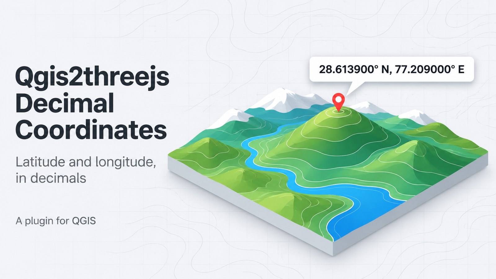
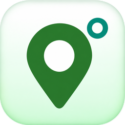

<h1 align="center">Qgis2threejs Decimal Coordinates</h1>

<p align="center">
  
</p>

<p align="center">
  
</p>

<p align="center">
  <strong>Read Qgis2threejs query coordinates as plain decimal latitude and longitude.</strong><br>
  Six decimal places, in the live 3D viewer and in new HTML exports.
</p>

<p align="center">
  
  
  
  <a href="LICENSE"></a>
</p>

Qgis2threejs shows the position of a clicked object in degrees, minutes and seconds. GIS analysts, surveyors and web map authors often need decimal degrees to paste into a spreadsheet, a web map or a GPS device. This plugin converts the query result to decimal degrees.

What you can do:

- Click an object in the 3D viewer and read its position as `28.613900° N, 77.209000° E, Elev. 200.00`.
- Turn the display on and off from the Plugins menu or a toolbar icon. QGIS remembers the setting.
- Create HTML exports that show the same decimal format.

**The plugin changes only the text of the coordinate display.** Map data, projected X/Y values, measurements, height and camera controls stay as they are.

---

## Requirements

- QGIS 3.34 or later in the QGIS 3 series.
- Qgis2threejs **2.10.2**, installed and enabled. The plugin uses internal Qgis2threejs interfaces and stays inactive with other versions.
- A scene with queryable objects and a coordinate system that the Qgis2threejs geographic transform supports.

---

## Getting started

1. In QGIS, open **Plugins → Manage and Install Plugins → Install from ZIP** and select the plugin ZIP.
2. Enable both Qgis2threejs and Qgis2threejs Decimal Coordinates.
3. Select **Plugins → Qgis2threejs Decimal Coordinates → Decimal degree coordinates**, or click the toolbar icon. A check mark or a pressed icon shows that the setting is on.
4. Open the Qgis2threejs viewer. In scene properties, choose **World → Coordinate Display → Latitude and longitude** and apply the settings.
5. Click a queryable object in the 3D viewer. The query result shows latitude and longitude to six decimal places.

---

## Features

| Feature | What it does |
|---|---|
| Decimal display | Shows latitude and longitude with six decimal places. Latitude comes first. |
| Signed values | South and west values are negative. `-10.000000° N, -20.000000° E` is south and west of the origin. |
| Axis labels | N and E mark the geographic axes. The values are latitude and longitude, not projected northing and easting. |
| Elevation | Elevation stays unchanged. |
| Toggle | A menu entry and a toolbar icon switch the display on and off. |
| Web export | New HTML exports get a companion script that applies the same format. |

If a DMS result is already visible when you enable the plugin, the conversion uses the rounded text on screen. Click the object again to use the original geographic values.

---

## Export a web scene

Enable the plugin and select **Latitude and longitude** in the scene properties before you create a Qgis2threejs HTML export. Keep `q3d_decimal_degrees_companion.js` next to the exported HTML when you move or share it.

Existing exports do not change. An export that you create while the plugin is off keeps the original coordinate display.

---

## Troubleshooting

| Problem | What to do |
|---|---|
| Coordinates do not change | Check that the plugin is enabled and that **Coordinate Display** is **Latitude and longitude**. Apply the scene settings and click a queryable object again. |
| Unsupported version warning | Install and enable Qgis2threejs 2.10.2. |
| Menu or toolbar icon is missing | Check that the plugin is enabled in the QGIS Plugin Manager. If it failed to load, read the QGIS Python error message and log. |
| An export shows the original format | Create a new export with the plugin on. Keep the companion JavaScript file next to the HTML. Check the browser console for messages. |

For plugin warnings, open **View → Panels → Log Messages** and select **Qgis2threejs Decimal Coordinates**.

---

## Limits

- Tested only on QGIS 4.2.3 with a native load, toggle and unload test. QGIS 3.x, WebEngine, other platforms and a real Qgis2threejs 2.10.2 viewer are not tested in the current release. Earlier local smoke tests reported QGIS 3.34.14, 3.42.2 and 3.44.12 with WebKit.
- The plugin wraps internal Qgis2threejs functions in memory. No supported extension hook for this behavior exists. Changes to Qgis2threejs, or other extensions that wrap the same functions, can cause conflicts.
- The plugin does not edit Qgis2threejs files. It removes its own hooks on unload where possible.
- The export integration rejects unexpected templates and conflicting companion scripts. If it fails, the original exporter may already have created output files.
- Test your own scenes and browser before you distribute an export.

---

## For developers

Build and validate the ZIP:

```bash
python3 scripts/package_plugin.py
python3 scripts/validate_plugin.py dist/Qgis2threejs_Decimal_Coordinates.zip
```

Run the native test with the QGIS Python bindings:

```bash
QT_QPA_PLATFORM=offscreen PYTHONPATH=/usr/share/qgis/python:/usr/lib/python3/dist-packages \
  /usr/bin/python3 -m pytest -q tests
```

---

## Contributing

Report problems and ideas in the [issue tracker](https://github.com/vchhikara/Qgis2threejs-Decimal-coordinates/issues).

## License

GPL-3.0-or-later. See [LICENSE](LICENSE) for the full license text.

## Author

Vipul Chhikara, India  
Email: vipul.chhikara@gmail.com
